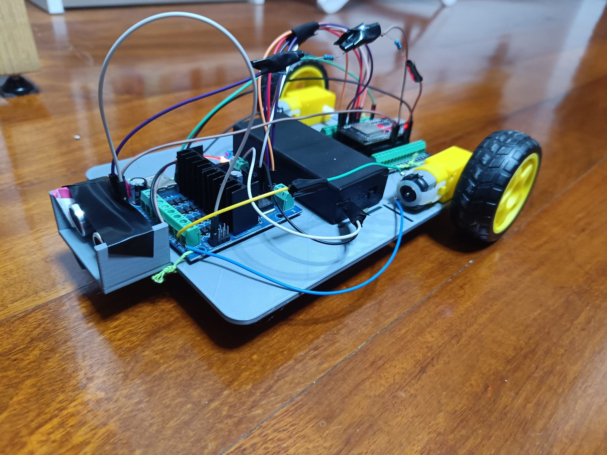
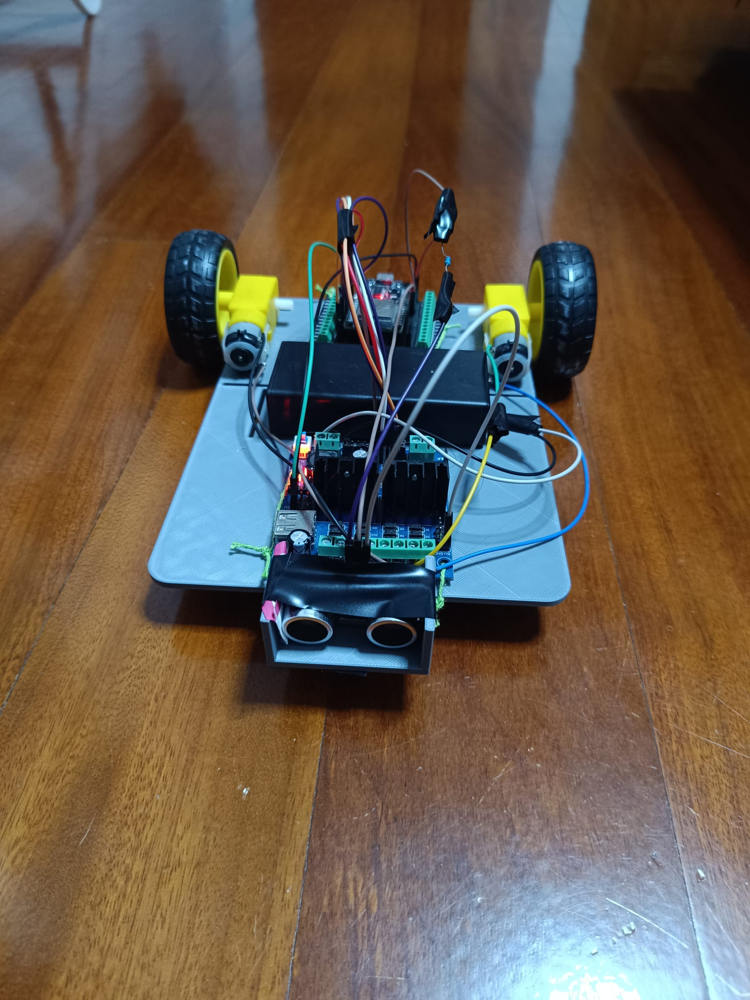
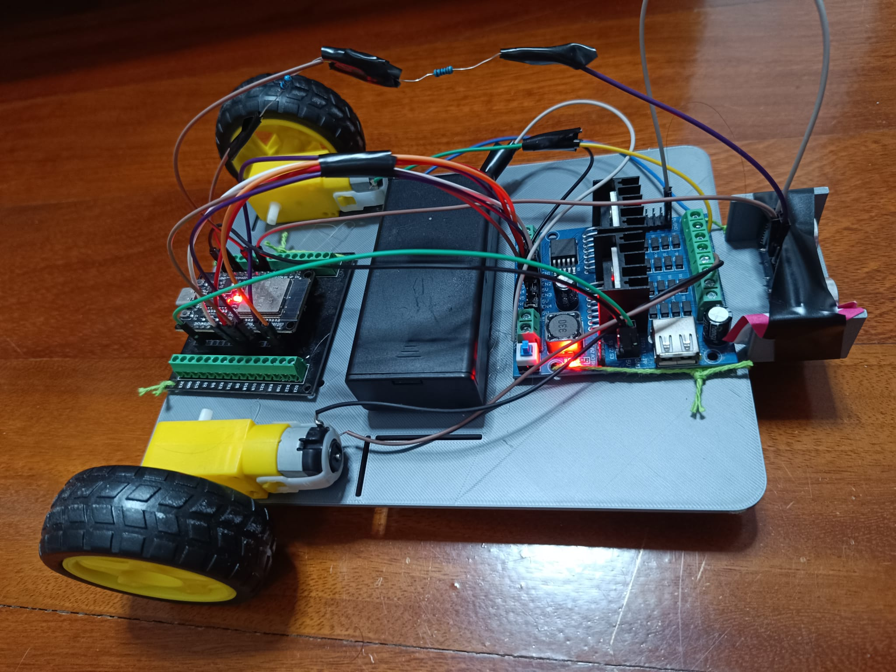
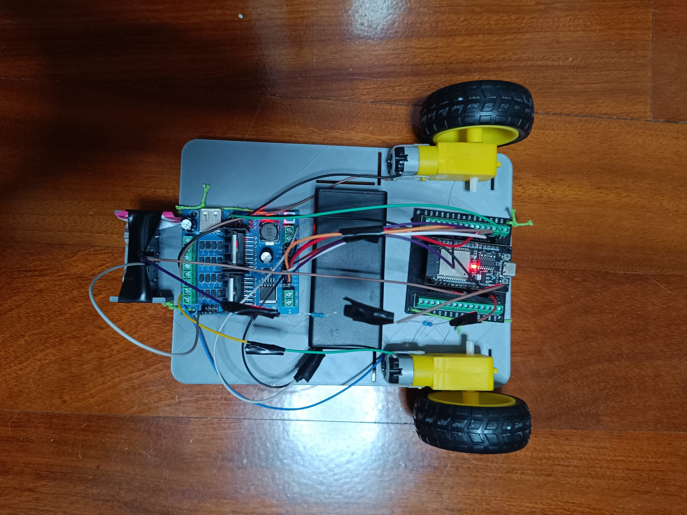
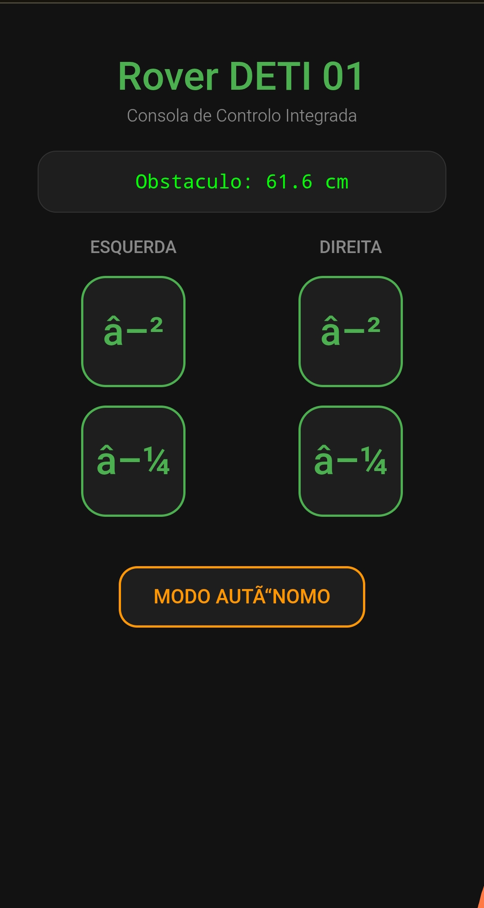

# 🤖 Rover DETI 01: ESP32 Web-Controlled Robot

   



> **Status: ✅ Complete.** All planned phases (firmware and electronics, networking and web server, automation and sensing) are built and verified on the finished rover: low-level motor control, a self-hosted web interface, real-time telemetry and autonomous obstacle avoidance. The final chassis is the 3D-printed **V4** design.

## 🎥 Demo

https://github.com/user-attachments/assets/e125297e-9ce1-4c44-8572-97c227e23245

## 📖 About the Project
**Rover DETI 01** is an IoT exploration robot powered by an **Asynchronous ESP32 Microcontroller**.
Unlike simple remote-controlled cars, this project focuses on **Low-Level Networking** and **Embedded Systems**. The robot hosts its own Web Server (HTTP), allowing control via any browser (Mobile/Desktop) over Wi-Fi, demonstrating the interaction between Hardware logic (C++) and Web interfaces.

## 🎯 Project Focus
The main goal of this project was to **explore the hardware and assembly side** of embedded systems: choosing and wiring components, soldering, power delivery (voltage dividers, buck converters, motor drivers), mechanical design and building a working robot. The firmware was **not** the focus: it is functional rather than a coding showcase.

## 🤖 AI Usage Disclosure
An AI assistant (**Gemini**, by Google) was used throughout this project as a build aid. For full transparency:

**What the AI did**
- **Firmware:** the C/C++ firmware, including the embedded web server and the web control interface (HTML/CSS/JavaScript), was **written by Gemini**. I did not write this code myself.
- **Parts list:** it helped me put together the shopping list (see [`docs/bom.md`](docs/bom.md)).
- **Assembly:** it guided me through assembling the rover.
- **Pin assignments:** it helped me decide which ESP32 pins to use for the motor driver and the sensor.

**What I did**
- Built the rover: assembly, soldering, wiring and the power system.
- Designed the chassis in SolidWorks (V1 to V4).
- Flashed the firmware and tested it on the real hardware, including the web interface and the obstacle avoidance.
- Documented the project. The README, BOM and build notes were drafted with the help of Claude (Anthropic) and reviewed by me.

Because the firmware is AI-generated, please treat it as a working reference for this hardware, not as a demonstration of my programming skills.

## ✨ Features
- Self-hosted web server: the rover creates its own Wi-Fi access point, no router or internet needed.
- Responsive control panel with momentary **tank steering**, multi-touch and mouse support.
- PWM speed control (calibrated) for forward, backward and stop.
- **Autonomous obstacle avoidance** with an ultrasonic sensor, with manual override.
- **Real-time distance telemetry** shown on the web interface.
- Non-blocking firmware (`millis()`-based) with communication safety nets.

## 🖼️ Gallery

| Front | Side | Top | Diagonal |
|:---:|:---:|:---:|:---:|
|  |  |  |  |

### 📱 Web Control Interface
The control panel runs on the rover itself and opens in any phone browser:

<p align="center">
  
</p>

## 📁 Repository Structure
```
Robot_Car/
├── firmware/
│   ├── current/           # Firmware currently running on the rover
│   └── dev-history/       # Earlier iterations, kept to show progression
├── cad/
│   ├── v1/                # Initial chassis design
│   ├── v2/                # Revised chassis with mounts for battery, ESP32, L298N, motor, sensor
│   ├── v3/                # Intermediate iteration (superseded by V4)
│   └── v4/                # Final design, as built
├── docs/
│   ├── bom.md             # Bill of materials
│   └── build-notes.md     # Build log, lessons learned
├── media/
│   ├── images/            # Photos of the finished rover
│   └── video/             # Short demo clips (if small enough)
├── LICENSE
└── README.md
```

## ⚙️ Hardware & Tech Stack
*   **Microcontroller:** ESP32 DevKit (Wi-Fi/Bluetooth) on a screw-terminal expansion board.
*   **Firmware:** C/C++ (Arduino IDE / PlatformIO) featuring non-blocking tasks (`millis()`) and communication safety nets.
*   **Actuators:** 2x TT DC gear motors (3-6 V) driven by an L298N V3 "4-Way" module with an integrated LM2596S buck converter.
*   **Sensors:** HC-SR04 (Ultrasonic Distance Sensor) protected by a 1K/2K resistor voltage divider.
*   **Power:** 2x 18650 Li-ion batteries in series (7.4V nominal) in a holder with an integrated ON/OFF switch.
*   **Web Interface:** HTML5, CSS3, JavaScript (Asynchronous Fetch API with touch/mouse momentary event listeners and periodic telemetry polling).

Full parts list: [`docs/bom.md`](docs/bom.md).

## 🔧 Mechanical Design (V1 → V4)
The chassis was modelled in SolidWorks and 3D printed over several iterations.

| Version | Notes |
|---|---|
| **V1** | Initial chassis design |
| **V2** | Revised chassis with mounts for battery, ESP32, L298N, motor and sensor |
| **V3** | Intermediate iteration, superseded by V4 |
| **V4** | **Final design, used in the finished rover** (`cad/v4/`): single-deck chassis, 150 × 210 mm, with snap-fit walls for the sensor, holes for the boards and a spacer block for the caster ball |

## ⚠️ Known Issues & Lessons Learned
- **V4 mounting holes do not match the real component dimensions exactly.** I compensated with **wool padding** (ESP32 and motor driver) and **hot glue** (TT motors and battery holder), which held the components firmly in place, and the rover works reliably. If you print `cad/v4/` yourself, expect to adjust the hole sizes for your own parts.
- A future revision (V5) should start from **caliper measurements of the real parts**, add printing tolerances to the holes, and use small test prints of the mounting patterns before printing the whole chassis.
- More details in [`docs/build-notes.md`](docs/build-notes.md).

## 🚀 Getting Started
1. Open `firmware/current/` in the Arduino IDE or PlatformIO and install the ESP32 board support.
2. Set the Wi-Fi access point name and password in the firmware. **Never commit real credentials to a public repository.**
3. Flash the ESP32 and power the rover (2x 18650 pack, power switch on).
4. Connect your phone or laptop to the rover's Wi-Fi access point.
5. Open the rover's address in a browser (the ESP32 access point address is `192.168.4.1` by default, adjust if you changed it) to get the control panel.

## 🗺️ Roadmap
Development was divided into sequential engineering phases:

### Phase 1: Hardware & Low-Level Control
- [X] Component acquisition (Motors, Chassis, Drivers, Batteries).
- [X] Circuit Assembly (Bench-test electronics successfully wired, including common ground verification).
- [X] Firmware implementation: Motor control logic (Forward, Backward, Stop with PWM speed control calibrated).
- [X] Physical Chassis Modeling (V1 to V4 completed, V4 built and running, see `/cad`).

### Phase 2: Networking & Web Server
- [X] ESP32 Wi-Fi Configuration (Access Point Mode).
- [X] Embedded Web Server implementation (Handling Asynchronous HTTP Requests via unified routes).
- [X] Frontend Control Panel (Responsive Momentary Tank Steering UI with multi-touch event listeners).

### Phase 3: Automation & Sensing
- [X] Ultrasonic Sensor integration (with 1K/2K resistor voltage divider protection for 3.3V ESP32 pins).
- [X] Autonomous Obstacle Avoidance logic (using non-blocking `millis()` loops and manual override).
- [X] Real-time distance telemetry display on the Web Interface.

### Phase 4: Possible Future Work (not planned for now)
- [ ] Video Streaming (Camera Module).
- [ ] Bluetooth Low Energy (BLE) alternative control.
- [ ] V5 chassis with corrected hole tolerances.

## 🔒 Security Note (Future Work)
As part of my interest in **Cybersecurity**, future updates could focus on securing the communication channel:
*   Implementing authentication for the Web Server.
*   Analyzing network packets between the client and the rover.

## 📄 License
Released under the [MIT License](LICENSE).

---
**Note:** This project is part of my personal portfolio as a Computer Engineering (LECI) student at the University of Aveiro (UA), Portugal.
